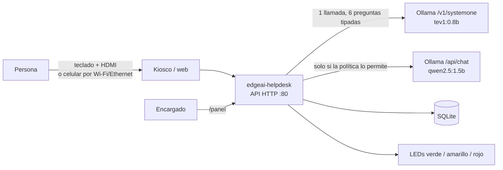

# Mesa de ayuda EdgeAI

Sistema inteligente de borde para **Raspberry Pi 4** que atiende consultas de un laboratorio
sin depender de la nube. Un **modelo de decisión System One (JEV)** servido por **Ollama**
clasifica cada consulta en una sola llamada tipada (categoría, urgencia, alcance, moderación,
datos sensibles y si es de autoservicio) y un **LLM pequeño** redacta la respuesta solo cuando
hace falta. El sistema operativo es una imagen Linux propia generada con **Yocto Project**.

Proyecto II — Taller de Sistemas Embebidos, Tecnológico de Costa Rica (II semestre 2026).



## Qué hay en este repositorio

| Ruta | Contenido |
|---|---|
| `app/` | Aplicación (Python, solo biblioteca estándar): API + web, kiosco de texto, `edgeai-admin`, `edgeai-bench`, servicios systemd, reglas udev y configuración |
| `meta-edgeai/` | Capa Yocto: distro, plantillas de build, recetas de Ollama, de la app, de red, de modelos precargados, packagegroup, imagen y `config.txt` |
| `scripts/` | Verificar el host, preparar capas, construir, grabar la microSD, actualizar Ollama, generar el árbol de dependencias, desplegar la app |
| `tools/` | Simulador de Ollama (desarrollo sin Pi), exportador de modelos, filtro de grafos DOT |
| `tests/` | Pruebas automáticas (decisión, política, BD, LEDs, API de punta a punta) |
| `docs/` | Guía paso a paso, arquitectura, dependencias, recetas, hardware, API y guion de la demo |

## Inicio rápido

**Probar la aplicación en cualquier PC (sin Pi ni modelos):**

```bash
make test     # 32 pruebas
make dev      # kiosco en http://127.0.0.1:8080 y panel en /panel (simulador de Ollama)
```

**Generar e instalar la imagen** (Linux x86_64, ~100 GB libres; detalles en
[docs/guia-generacion-instalacion.md](docs/guia-generacion-instalacion.md)):

```bash
./scripts/check-host.sh            # requisitos del host
./scripts/setup-build.sh           # capas wrynose y build/raspberrypi4-64/
./scripts/build-image.sh           # bitbake edgeai-image (varias horas la primera vez)
./scripts/flash-sd.sh /dev/sdX     # microSD de 16 GB o más
```

Al arrancar, la Pi muestra el kiosco en la pantalla HDMI y publica la web en
`http://edgeai.local` (o la IP que aparece en el kiosco). Si la imagen no incluye los
modelos, el servicio `edgeai-provision` los descarga la primera vez que hay internet.

Para precargar los modelos, construir QEMU, ejecutar sus pruebas y generar la imagen
de Raspberry Pi: `./scripts/build-all.sh`. Active `EDGEAI_PRELOAD_MODELS = "1"` en
`edgeai-secrets.conf`. Los resultados quedan en `artifacts/`.

GitHub Actions genera ambas variantes al hacer push a `main`, con un runner propio
etiquetado `edgeai-yocto`. El registro obtiene automáticamente su token usando la sesión
GitHub del administrador. La configuración Wi-Fi de demostración se versiona; vea la
[guía](docs/guia-generacion-instalacion.md#13-github-actions).

## Documentación

- [Guía de generación e instalación de la imagen](docs/guia-generacion-instalacion.md)
- [Arquitectura del sistema](docs/arquitectura.md) (operacional, funcional y física)
- [Análisis de dependencias](docs/dependencias.md)
- [Recetas y capa Yocto](docs/recetas.md)
- [Hardware y conexiones](docs/hardware.md)
- [API HTTP](docs/api.md)
- [Guion de la demostración y casos de uso](docs/demo.md)

## Versiones

| Componente | Versión |
|---|---|
| Yocto Project | *wrynose*, revisiones fijadas en `layers.lock` |
| BSP | meta-raspberrypi (wrynose), `raspberrypi4-64`; QEMU `qemuarm64` |
| Ollama | 0.40.6 (binario oficial arm64; `/v1/systemone` existe desde 0.35) |
| Modelo de decisión | `tev1:0.8b` (System One, ~0.8 GB) |
| LLM | `qwen2.5:1.5b` (~1 GB), configurable |
| Python | El provisto por wrynose; CI de la aplicación con Python 3.14 |
