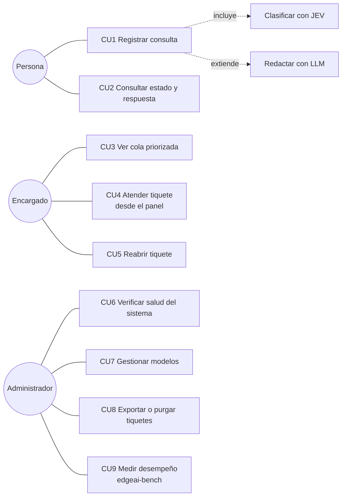
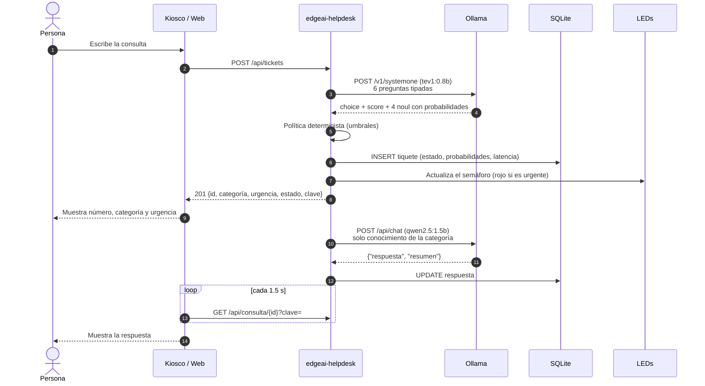
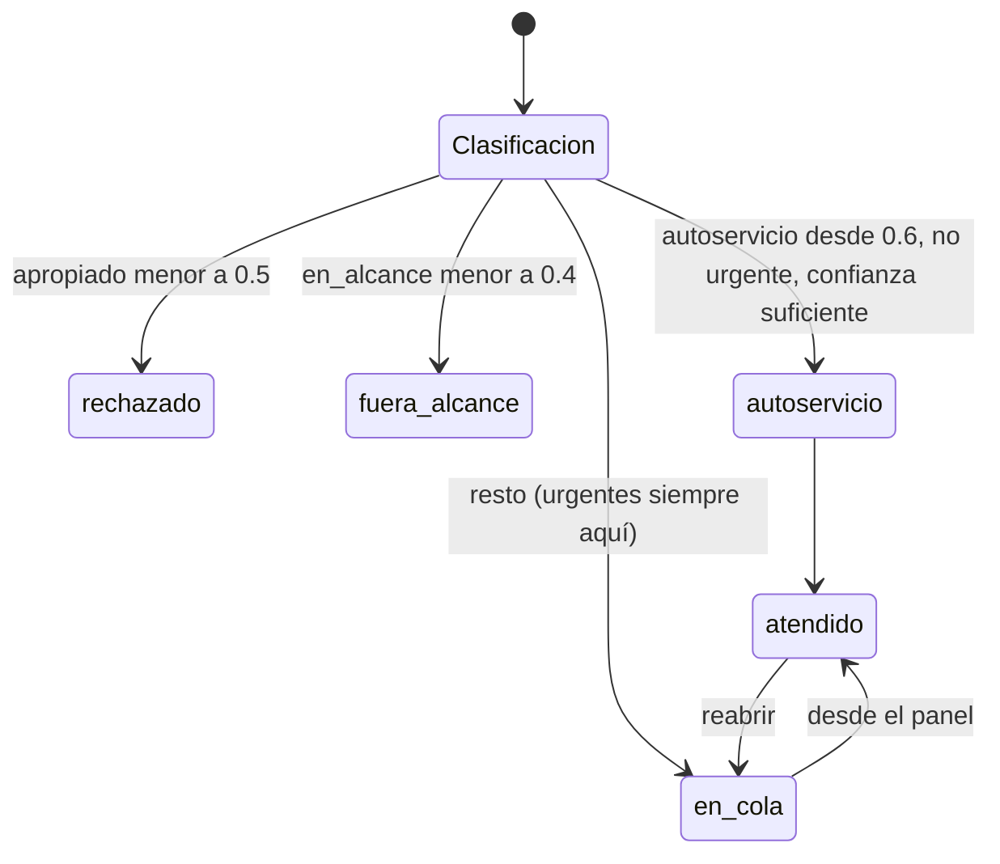
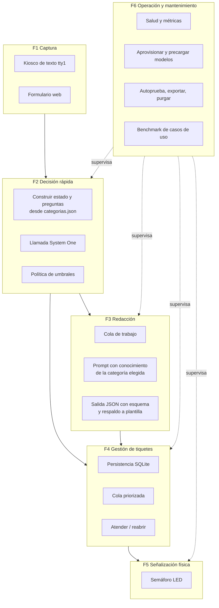
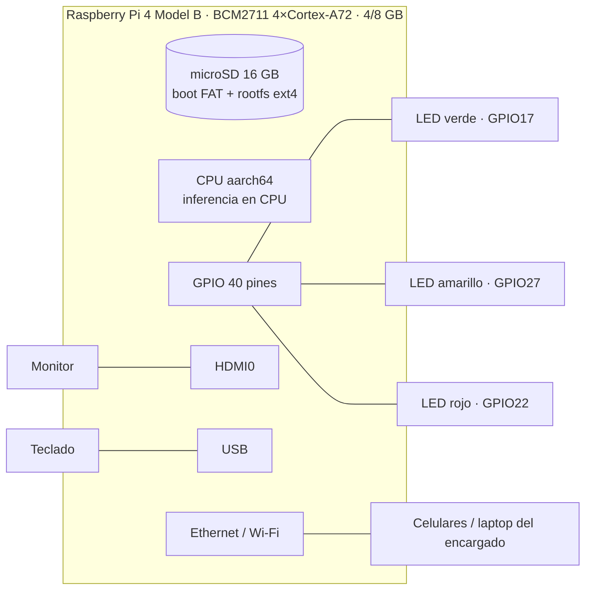
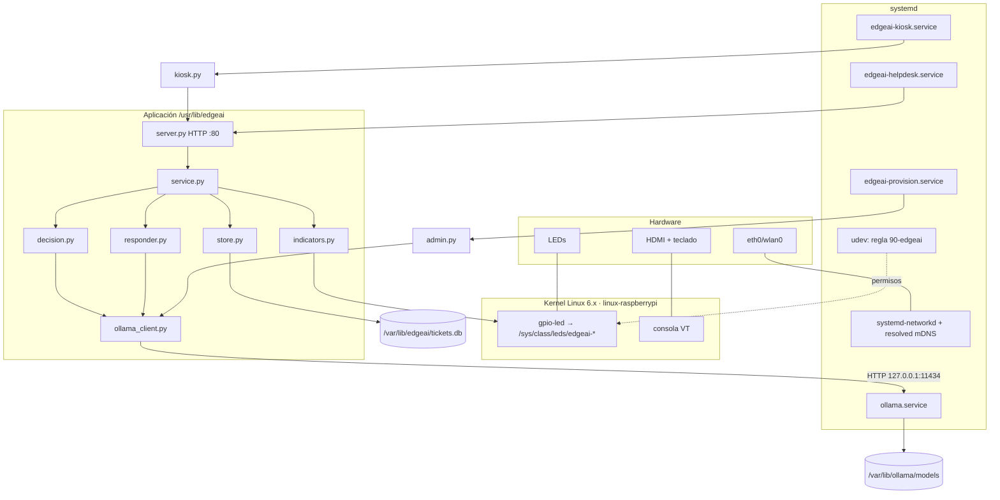

# Arquitectura del sistema

Este documento describe la solución implementada en tres vistas (operacional, funcional y
física) y el mapeo entre funciones y componentes. Sirve de base para las secciones 4 a 8 de
la propuesta de diseño.

## 1. Concepto de operación

Una persona (estudiante o docente) se acerca al kiosco del laboratorio, o abre la página web
desde su celular, y escribe su problema en lenguaje natural. En menos de lo que tarda en
generarse una oración, el sistema ya decidió **qué tipo de caso es, qué tan urgente es, si
corresponde al servicio, si el mensaje es apropiado, si trae datos sensibles y si la persona
puede resolverlo sola**. Con esa decisión:

- Los casos urgentes encienden el **LED rojo** para alertar al encargado.
- Los casos de autoservicio reciben pasos concretos redactados por el LLM y no saturan la cola.
- Los mensajes fuera de alcance o inapropiados reciben una plantilla fija, sin gastar el LLM.
- El resto entra a la **cola priorizada** que el encargado ve en `/panel` y atiende desde el
  panel ("atender siguiente" o tiquete por tiquete).

Todo ocurre dentro de la Raspberry Pi: no hay costo por consulta, no se envían datos a
terceros y funciona sin internet.

### Actores

| Actor | Interacción |
|---|---|
| Persona usuaria | Escribe consultas en el kiosco (tty1) o la web; recibe número de tiquete, categoría, urgencia y respuesta |
| Encargado/a del laboratorio | Atiende la cola desde el panel web; observa el semáforo de LEDs |
| Administrador/a técnico | Instala la imagen, ajusta la configuración, actualiza modelos, revisa bitácoras (`edgeai-admin`, SSH) |
| Coordinación (actor externo) | Define el contenido de `categorias.json`: categorías, base de conocimiento, plantillas |

### Casos de uso

### Secuencia: registro de una consulta

La decisión es **síncrona** (la persona ve su número y urgencia de inmediato) y la redacción
es **asíncrona** (un hilo de trabajo procesa la cola del LLM uno a la vez, que es lo que la
RPi4 puede sostener).

### Estados de un tiquete

Además, `respuesta_estado` avanza `pendiente → generando → lista | error`, u `omitida` cuando
se usa plantilla. Si Ollama no responde, el tiquete **no se pierde**: entra a `en_cola` como
`sin_clasificar` con *revisión manual* (degradación controlada).

## 2. Vista funcional

| Función | Requisito que atiende | Implementación |
|---|---|---|
| F1 | Interacción local sin entorno gráfico y remota desde el celular | `kiosk.py`, `web/index.html` |
| F2 | Clasificación de baja latencia con probabilidades calibradas (JEV) | `decision.py` |
| F3 | Respuestas en lenguaje natural con un LLM de 1–3B | `responder.py` |
| F4 | Registro, priorización y trazabilidad | `store.py`, `service.py` |
| F5 | Señalización del estado con actuadores del embebido | `indicators.py`, overlay `gpio-led` |
| F6 | Administración del sistema embebido | `admin.py`, `bench.py`, `edgeai-provision.service` |

## 3. Vista física

### Presupuesto de memoria (RPi4 de 4 GB)

| Elemento | Aprox. |
|---|---|
| GPU (`GPU_MEM=64`) | 64 MB |
| Sistema base + systemd + Python | ~150 MB |
| `tev1:0.8b` cargado + caché KV (ctx 2048) | ~1.0–1.3 GB |
| `qwen2.5:1.5b` cargado + caché KV (ctx 2048) | ~1.2–1.5 GB |
| Margen | ~1 GB |

Por eso `OLLAMA_CONTEXT_LENGTH=2048`, `OLLAMA_NUM_PARALLEL=1` y prompts cortos (solo el
conocimiento de la categoría elegida). Con 8 GB hay holgura para un LLM de 3B.

## 4. Arquitectura de software y mapeo a componentes

| Interfaz | Tipo | Detalle |
|---|---|---|
| Kiosco/Web ↔ API | HTTP/JSON | [api.md](api.md) |
| API ↔ Ollama | HTTP/JSON local | `/v1/systemone`, `/api/chat`, `/api/tags`, `/api/pull` |
| App ↔ LEDs | sysfs | escribir `0/1` en `brightness` (grupo `edgeai` vía udev) |
| App ↔ Datos | SQLite WAL | `/var/lib/edgeai/tickets.db` |
| Usuario ↔ Pi | mDNS | `edgeai.local` publicado por systemd-resolved |

## 5. Decisiones de diseño

1. **JEV delante del LLM.** Una sola llamada a `/v1/systemone` responde seis preguntas
   tipadas con probabilidades. El LLM, que es lo caro, solo se usa cuando la política lo
   permite y con un prompt reducido a la categoría elegida.
2. **Política determinista separada del modelo.** Los umbrales viven en `helpdesk.conf`: se
   pueden ajustar con datos de `edgeai-bench` sin tocar código ni modelos, y cada decisión
   queda auditada con sus probabilidades en la base de datos.
3. **Hardware declarado en el árbol de dispositivos.** El overlay `gpio-led` hace que el
   kernel exponga los LEDs como dispositivos estándar: la aplicación no necesita bibliotecas
   de GPIO ni privilegios de root.
4. **Python sin dependencias externas.** Solo biblioteca estándar: la imagen no necesita
   meta-python ni meta-openembedded y el árbol de dependencias es corto.
5. **Binario oficial de Ollama.** Compilar Ollama dentro de Yocto exige Go, CMake y módulos
   descargados durante el build; el binario oficial arm64 es reproducible (hash fijo) y se
   recorta a los backends de CPU.
6. **Degradación controlada.** Sin Ollama los tiquetes siguen entrando (revisión manual); sin
   LED físicos el panel muestra LEDs simulados; sin red la Pi responde por link-local.
7. **Privacidad.** Ollama escucha solo en `127.0.0.1`; cada tiquete tiene una clave para que
   el kiosco consulte solo el propio; el panel puede exigir `X-Panel-Token`; los mensajes con
   datos sensibles se marcan y la respuesta lo recuerda.
