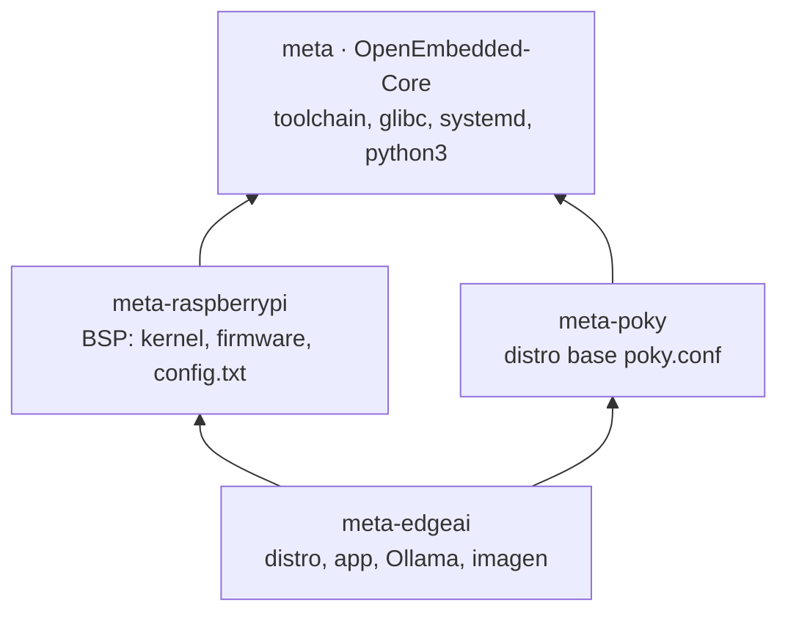
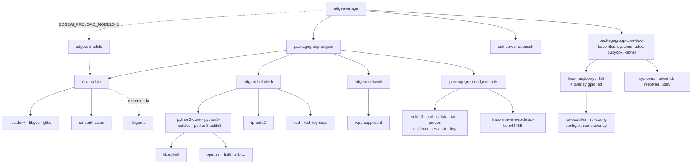

# Análisis de dependencias

Este documento identifica las dependencias de software, a nivel de sistema operativo, que la
imagen necesita para la mesa de ayuda, y cómo se resuelven en Yocto. Las gráficas exactas
del build se generan con `./scripts/dependency-graph.sh` (ver la última sección).

## 1. Capas



Solo se usan **cuatro capas**. No se necesita `meta-openembedded` ni `meta-python`: la
aplicación usa únicamente la biblioteca estándar de Python y todas las utilidades provienen
de OE-Core. `LAYERDEPENDS_edgeai = "core raspberrypi"` y
`LAYERSERIES_COMPAT_edgeai = "wrynose"`.

## 2. Árbol de dependencias de la imagen



### Dependencias de compilación de las recetas propias

| Receta | Hereda | Depende (build) | Fuente |
|---|---|---|---|
| `ollama-bin` | `systemd`, `useradd` | `zstd-native` (descomprimir `.tar.zst`, lo agrega `base.bbclass`), `shadow-native` (useradd) | GitHub release `ollama-linux-arm64.tar.zst` + `ollama.service`, `ollama.env` |
| `edgeai-helpdesk` | `allarch`, `systemd`, `useradd` | `shadow-native` | `file://app` (directorio `app/` del repositorio) |
| `edgeai-network` | `allarch` | — | archivos `.network` y `resolved.conf.d` |
| `edgeai-models` | `allarch`, `useradd` | `shadow-native` | `models/ollama-models.tar` (opcional) |
| `packagegroup-edgeai` | `packagegroup` | — | — |
| `edgeai-image` | `core-image`, `extrausers` | toda la cadena de herramientas, kernel, wic | — |
| `rpi-config` (bbappend) | — | — | agrega líneas a `config.txt` |

### Dependencias de ejecución

**Ollama (`/usr/bin/ollama`, binario Go con cgo y bibliotecas ggml):**

| Necesita | Paquete Yocto | Motivo |
|---|---|---|
| `libc.so.6`, `libm`, `libpthread`, `libdl`, `librt`, `ld-linux-aarch64.so.1` | `glibc` (automático por shlibs) | binario dinámico de glibc |
| `libstdc++.so.6`, `libgcc_s.so.1` | `libstdc++`, `libgcc` | backends de ggml en C++ |
| `libgomp.so.1` (si el backend lo usa) | `libgomp` (RRECOMMENDS) | paralelismo OpenMP en CPU |
| Certificados TLS | `ca-certificates` | `ollama pull` desde registry.ollama.ai |
| `libggml-base.so`, `libggml-cpu-*.so` | incluidos en `/usr/lib/ollama` | backends de CPU; se descartan CUDA/JetPack/ROCm/Vulkan/MLX |

Para comprobarlo sobre la imagen construida:

```bash
source sources/openembedded-core/oe-init-build-env build/raspberrypi4-64
oe-pkgdata-util list-pkg-files ollama-bin
oe-pkgdata-util read-value RDEPENDS ollama-bin
readelf -d tmp/work/*/ollama-bin/*/image/usr/bin/ollama | grep NEEDED   # RM_WORK_EXCLUDE la conserva
```

**Aplicación (`edgeai-helpdesk`):** módulos de la biblioteca estándar que usa, todos dentro
de `python3-modules` (más `python3-sqlite3`, que trae `libsqlite3`):

| Módulo | Para qué |
|---|---|
| `http.server`, `socketserver` | API y páginas web |
| `urllib.request` | cliente de Ollama y del kiosco |
| `sqlite3` | tiquetes |
| `json`, `configparser`, `dataclasses` | configuración y datos |
| `threading`, `queue` | hilo de redacción, salud e indicadores |
| `select` | lectura del teclado del kiosco con tiempo de espera |
| `hmac`, `secrets` | token del panel y clave por tiquete |
| `argparse`, `logging`, `csv`, `statistics`, `subprocess` | CLI, bitácora, exportación, benchmark |

Además: `iproute2` (el kiosco muestra las IP con `ip -4 addr`) y `kbd`/`kbd-keymaps`
(el servicio del kiosco ejecuta `loadkeys la-latin1` para el teclado latinoamericano).

**Servicios del sistema que se dan por hechos:** `systemd` (unidades, `StateDirectory`,
`TTYPath`, `AmbientCapabilities`), `systemd-networkd`, `systemd-resolved` (mDNS),
`udev` (regla `90-edgeai.rules`), `systemd-sysctl` (`90-edgeai.conf`).

## 3. Dependencias del host de build

Paquetes de Ubuntu/Debian para el host Yocto wrynose: `gawk wget git diffstat unzip texinfo
gcc build-essential chrpath socat cpio python3 python3-pip python3-pexpect xz-utils
debianutils iputils-ping python3-git python3-jinja2 python3-subunit zstd liblz4-tool file
locales libacl1`, más `bmap-tools` para grabar la microSD y `graphviz` para las gráficas.
`scripts/check-host.sh` los verifica.

## 4. Regenerar las gráficas reales

```bash
./scripts/dependency-graph.sh
```

Produce en `docs/generated/`:

| Archivo | Contenido |
|---|---|
| `recetas-build.txt` | todas las recetas que BitBake construye para la imagen (`pn-buildlist`) |
| `edgeai-build-deps.dot/.svg` | dependencias de compilación directas de las recetas propias (de `bitbake -g`) |
| `edgeai-runtime-deps.dot/.svg` | dependencias de ejecución de los paquetes propios, dos niveles (de `buildhistory`) |
| `paquetes-instalados.txt` | cada paquete de la imagen con su tamaño |
| `image-info.txt` | resumen de la imagen (tamaño del rootfs, `IMAGE_INSTALL` final) |

`buildhistory` está activado en `local.conf` precisamente para esto: después de cada build
registra qué paquetes entraron y cuánto pesan.
