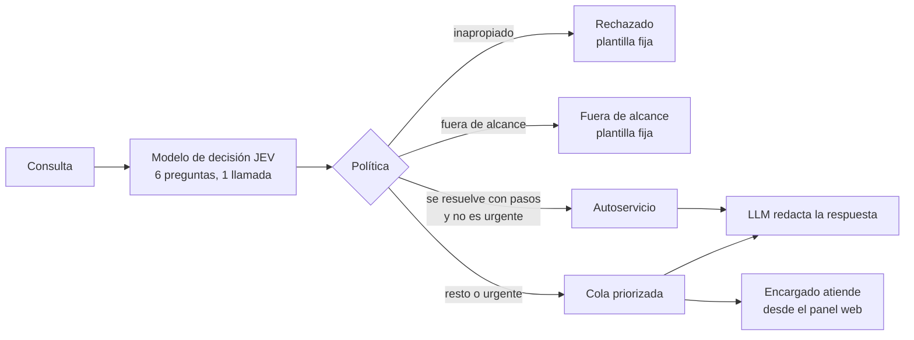
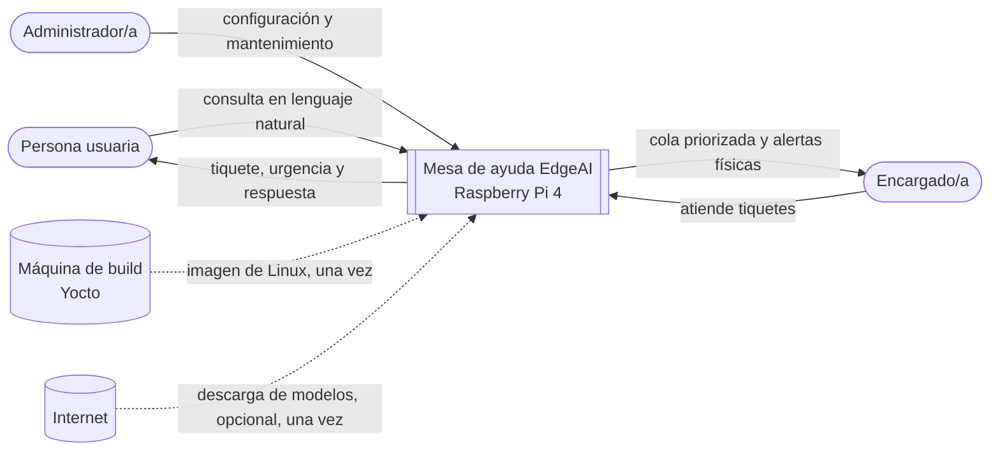
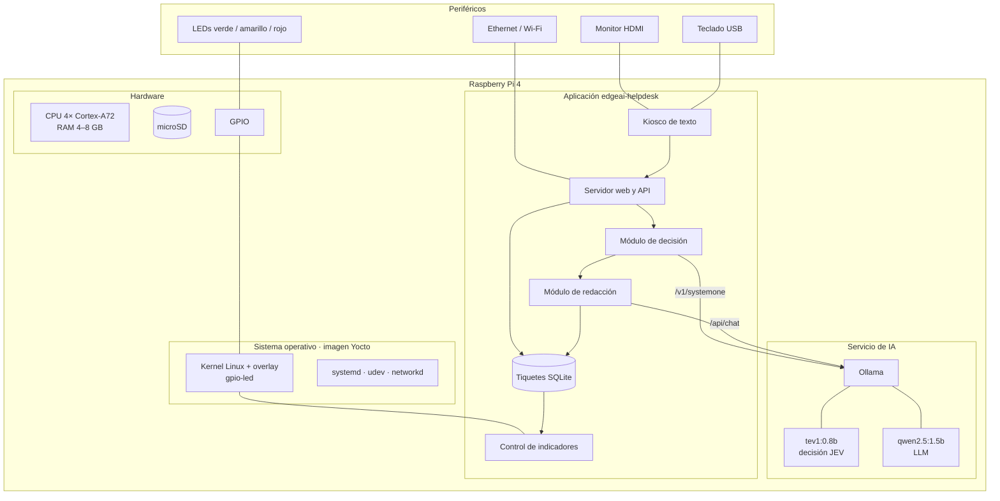
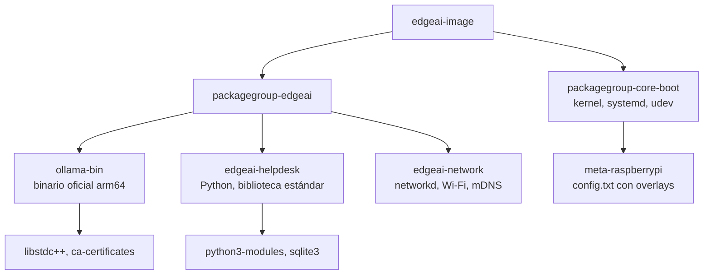
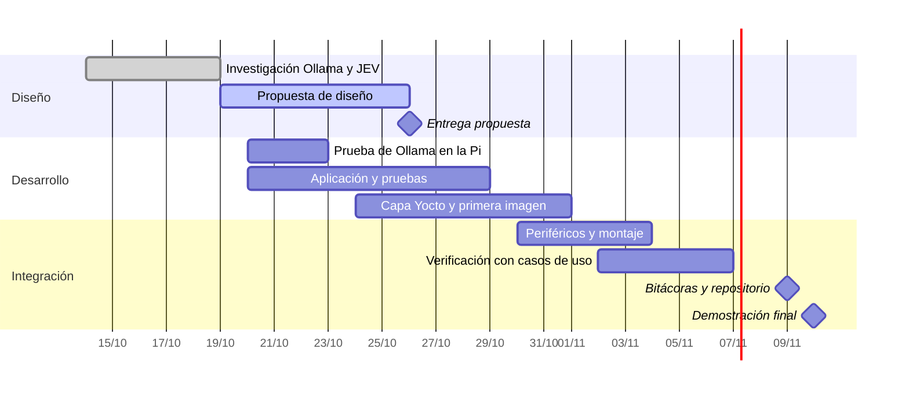

# Propuesta de diseño: Mesa de ayuda EdgeAI

**Proyecto II: Sistemas Inteligentes de Borde (EdgeAI)**
Taller de Sistemas Embebidos, Tecnológico de Costa Rica · Entrega: 26 de octubre de 2026

---

## 1. Resumen

Proponemos una **mesa de ayuda inteligente para el Laboratorio de Electrónica** que funciona
completamente dentro de una **Raspberry Pi 4**, sin servicios en la nube. La persona escribe su
consulta en lenguaje natural y el sistema la **clasifica, prioriza y responde** de forma local.

El diseño combina dos tipos de modelo ejecutados con **Ollama**:

| Modelo | Tipo | Rol |
|---|---|---|
| `tev1:0.8b` | Modelo de decisión (API **JEV**, endpoint `/v1/systemone`) | Decide en una sola llamada: categoría, urgencia, alcance, moderación, datos sensibles y autoservicio |
| `qwen2.5:1.5b` | LLM pequeño | Redacta la respuesta en español, solo cuando hace falta |

El sistema operativo es una imagen de Linux propia generada con **Yocto Project**.

## 2. Problema

En el laboratorio, las consultas llegan desordenadas y mezclan casos muy distintos:

- **Urgentes:** humo en un tomacorriente o una fuga de agua sobre los equipos.
- **Autoservicio:** cómo conectarse al Wi-Fi o qué se necesita para un préstamo.
- **Fuera de alcance o inapropiadas:** consultas que no le corresponden al laboratorio.

Hoy el encargado filtra todo a mano y un caso crítico puede quedar detrás de uno trivial. Las
soluciones en la nube resuelven la clasificación, pero cobran por consulta, dependen de internet
y envían datos personales (nombres, usuarios, a veces contraseñas) a terceros.

**Por qué en el borde:** privacidad (nada sale del equipo), costo cero por consulta,
funcionamiento sin conexión y baja latencia.

## 3. Actores

| Actor | Interacción con el sistema |
|---|---|
| Persona usuaria (estudiante o docente) | Escribe su consulta en el kiosco o desde el celular y recibe tiquete, urgencia y respuesta |
| Encargado/a del laboratorio | Atiende la cola priorizada desde el panel web y observa el semáforo de LEDs |
| Administrador/a técnico | Instala la imagen, configura y actualiza modelos (SSH, `edgeai-admin`) |
| Coordinación del laboratorio | Define las categorías, la base de conocimiento y las plantillas de respuesta |

## 4. Requerimientos principales

| ID | Requerimiento |
|---|---|
| RF-01 | Recibir consultas en texto libre desde un kiosco local (monitor y teclado) y desde un navegador web |
| RF-02 | Clasificar cada consulta con un modelo de decisión JEV: categoría, urgencia (0–3), alcance, moderación, datos sensibles y autoservicio |
| RF-03 | Generar una respuesta en español con un LLM local usando la base de conocimiento de la categoría |
| RF-04 | Mantener una cola de tiquetes ordenada por urgencia y permitir marcarlos como atendidos |
| RF-05 | Señalizar el estado del sistema y de la cola con un semáforo de LEDs (verde, amarillo, rojo) |
| RF-06 | Rechazar mensajes inapropiados y fuera de alcance sin invocar el LLM |
| RNF-01 | Todo el procesamiento ocurre en la Raspberry Pi 4, sin servicios en la nube |
| RNF-02 | Operar sin conexión a internet una vez instalados los modelos |
| RNF-03 | La clasificación responde antes que la redacción: la persona ve su tiquete sin esperar al LLM |
| RNF-04 | Si Ollama falla, los tiquetes se siguen registrando para revisión manual |
| RNF-05 | Ningún servicio de la aplicación se ejecuta como root |
| RNF-06 | La imagen se genera de forma reproducible con Yocto Project (wrynose) |

## 5. Concepto de operación

1. La persona escribe su consulta en el **kiosco** o en `http://edgeai.local` desde su celular.
2. **Ruta rápida:** el modelo de decisión responde seis preguntas tipadas en una sola llamada.
3. Una **política de umbrales** decide el destino del tiquete:

4. **Ruta lenta:** el LLM redacta la respuesta en segundo plano. La persona ya recibió su
   número de tiquete, categoría y urgencia.
5. **La persona recibe todo en el mismo dispositivo donde escribió:** si usó el kiosco, en el
   monitor de la Pi; si usó el celular, en la misma página web, que se actualiza sola cuando
   llega la respuesta.
6. Los **LEDs** reflejan el estado: un caso urgente enciende el rojo.
7. El encargado atiende desde el **panel web**.

La idea central es que **JEV va delante del LLM**: el modelo rápido decide todo y el modelo
lento solo se usa cuando aporta valor.

## 6. Diagrama de primer nivel (contexto)

El sistema visto como una caja negra, con sus actores y elementos externos.

Durante la operación normal el sistema **no depende de ningún elemento externo**. La máquina
de build se usa solo para generar la imagen, e internet solo para descargar los modelos (o se
incluyen en la imagen).

## 7. Diagrama de segundo nivel (subsistemas)

Descomposición interna en hardware, sistema operativo, servicios y aplicación.

| Subsistema | Responsabilidad |
|---|---|
| Hardware | Ejecutar la inferencia en CPU, almacenar el sistema y los modelos, exponer los GPIO |
| Sistema operativo | Kernel con el overlay que publica los LEDs como dispositivos estándar; systemd arranca y supervisa los servicios |
| Servicio de IA | Ollama carga ambos modelos en RAM y atiende las solicitudes locales |
| Aplicación | Captura consultas, aplica la política, gestiona la cola y controla los indicadores |

## 8. Periféricos

| Periférico | Conexión | Función |
|---|---|---|
| Monitor | HDMI0 (micro-HDMI) | Muestra el kiosco |
| Teclado | USB | Escribir consultas en el kiosco |
| LED verde + 330 Ω | GPIO17 (pin 11) | Sistema listo; parpadea mientras cargan los modelos |
| LED amarillo + 330 Ω | GPIO27 (pin 13) | Hay casos en cola; parpadea mientras el LLM redacta |
| LED rojo + 330 Ω | GPIO22 (pin 15) | Hay un caso urgente; parpadeo rápido si Ollama falla |
| Ethernet o Wi-Fi | RJ45 / integrado | Acceso web desde celulares y panel del encargado |
| microSD 16 GB+ | Ranura | Sistema operativo y modelos |
| Fuente USB-C 5 V / 3 A y disipador | — | Alimentación estable y control térmico durante la inferencia |

Los LEDs **no requieren bibliotecas de GPIO**: el overlay `gpio-led` del árbol de
dispositivos hace que el kernel los exponga en `/sys/class/leds/edgeai-*`, y la aplicación
los enciende escribiendo `1` o `0` en un archivo.

**Recursos de memoria (Pi de 4 GB):** cerca de 1–1.3 GB para el modelo de decisión, 1.2–1.5 GB
para el LLM y unos 200 MB para el sistema, lo que deja ~1 GB de margen.

## 9. Software y dependencias

Solo se usan cuatro capas: **meta** (OE-Core), **meta-poky**, **meta-raspberrypi** y la capa
propia **meta-edgeai**. La aplicación usa solo la biblioteca estándar de Python, por lo que no
necesita capas adicionales.

## 10. Estrategia de integración

1. **Validación temprana:** instalar Ollama en Raspberry Pi OS y medir la latencia real de
   `tev1:0.8b` y `qwen2.5:1.5b` antes de integrarlos a la imagen.
2. **Desarrollo de la aplicación en PC:** con un simulador de Ollama y pruebas automáticas, sin
   depender del hardware.
3. **Capa Yocto:** recetas para Ollama, la aplicación, la red y los overlays de GPIO; imagen
   `edgeai-image` para `raspberrypi4-64`.
4. **Integración en la Pi:** grabar la imagen, verificar con `edgeai-admin autoprueba` y conectar
   los periféricos.
5. **Verificación con casos de uso:** `edgeai-bench` ejecuta 12 casos (crítico, autoservicio,
   fuera de alcance, datos sensibles, etc.) y compara el resultado con lo esperado.

## 11. Planeamiento

## 12. Riesgos y consideraciones

| Riesgo | Mitigación |
|---|---|
| Latencia alta de los modelos en la CPU de la RPi4 | Medición temprana; prompts cortos; contexto de 2048 tokens; los modelos se mantienen cargados en RAM |
| Memoria insuficiente con ambos modelos | Pi de 4 GB como mínimo; opción de cargar un modelo a la vez |
| Primer build de Yocto largo (2–6 h) | Usar un servidor; reutilizar `sstate-cache` en los builds siguientes |
| Sin internet el día de la demo | Incluir los modelos dentro de la imagen |
| Clasificaciones erróneas | Umbrales configurables, revisión manual cuando la confianza es baja, ajuste con `edgeai-bench` |

## 13. Conclusiones

- La propuesta aprovecha las dos capacidades de Ollama que pide el proyecto: el **modelo de
  decisión JEV** para clasificar rápido y con probabilidades, y el **LLM** para redactar solo
  cuando aporta valor.
- Todo corre en la Raspberry Pi 4, lo que garantiza privacidad, costo cero por consulta y
  operación sin conexión.
- Los LEDs del semáforo se integran mediante el árbol de dispositivos, sin
  código de bajo nivel en la aplicación.
- El aspecto más importante para la implementación es **medir el rendimiento real en la Pi**
  al inicio, porque de eso depende el ajuste de modelos y tiempos.
